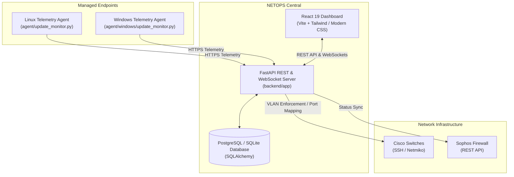

# NETOPS - Network & Endpoint Operations Platform

[](https://fastapi.tiangolo.com)
[](https://react.dev)
[](https://www.python.org)
[](https://www.postgresql.org)
[](https://www.docker.com)
[]()

**NETOPS** is an enterprise-grade Network and Endpoint Operations management platform designed to automate network discovery, enforce device access policies, monitor endpoint patch and security health, and provide real-time auditing and compliance reporting.

---

## 🚀 Key Features

### 🔍 Automated Network Discovery & Device Classification
* Discover active devices across local subnets and switches using ARP, ICMP, and neighbor protocols.
* Automatic vendor MAC OUI resolution and intelligent OS / device type classification (Workstations, Servers, IoT, Network Infrastructure).
* Port-level switch mapping: inspect MAC address tables and identify physical switch port connections.

### 🛡️ Dynamic Access Enforcement & VLAN Automation
* **VLAN Steering & Quarantine**: Automatically quarantine non-compliant, unmanaged, or compromised devices by reassigning switch access VLANs.
* **Scheduled Access Control**: Define granular recurring or one-time network access schedules (e.g. restrict device network connectivity outside work hours).
* **Multi-Vendor Network Integration**:
  * **Cisco IOS / Catalyst**: Automated SSH switch port query and VLAN changes via Netmiko.
  * **Sophos Firewall**: Read-only inspection and perimeter synchronization.

### 💻 Endpoint Telemetry & Update Monitoring
* Lightweight background telemetry agent compatible with both **Linux** and **Windows**.
* Tracks OS version, pending security patches, reboot-pending status, and endpoint IP/MAC addresses.
* Periodic heartbeat communication back to the NETOPS central backend to enforce patch compliance.

### 📊 Auditing, Real-Time Streaming & Reporting
* **Real-time Eventing**: Live WebSocket stream broadcasting device discoveries, access enforcement actions, and security alerts directly to the web console.
* **Executive Reports**: Instant one-click generation and download of network inventory and event logs in formatted **PDF** (via ReportLab) and **Excel (.xlsx)** (via OpenPyXL).
* **Simulation Mode**: Built-in mock event and discovery simulation for staging and demonstration without requiring physical hardware.

---

## 🏛️ System Architecture



---

## 📂 Project Structure

```text
NETOPS/
├── agent/                         # Endpoint telemetry agents
│   ├── update_monitor.py          # Linux telemetry agent
│   └── windows/                   # Windows-specific telemetry agent (WMI / COM)
├── backend/                       # FastAPI application
│   ├── app/
│   │   ├── api/                   # REST API routes (devices, reports, cisco, sophos, etc.)
│   │   ├── models/                # SQLAlchemy database models
│   │   ├── schemas/               # Pydantic validation schemas
│   │   ├── services/              # Business logic (discovery, VLAN automation, enforcement)
│   │   ├── config.py              # Environment configuration (pydantic-settings)
│   │   ├── database.py            # Database session and engine setup
│   │   └── main.py                # FastAPI app entry point & WebSocket handlers
│   ├── tests/                     # Test suite (91 comprehensive unit/integration tests)
│   ├── requirements.txt           # Python dependencies
│   └── .env.example               # Template for backend environment variables
├── frontend/                      # React 19 web management console
│   ├── src/                       # UI components, views, styles, and hooks
│   ├── public/                    # Static assets and icons
│   ├── nginx.conf                 # Production reverse-proxy Nginx configuration
│   ├── package.json               # Node.js dependencies & scripts
│   └── vite.config.js             # Vite bundler configuration
├── Dockerfile.backend             # Production Docker container for FastAPI backend
├── Dockerfile.frontend            # Production Docker container for React/Nginx frontend
└── README.md                      # Project documentation
```

---

## ⚡ Quick Start

### Prerequisites
* **Python 3.12+**
* **Node.js 18+** & npm
* **PostgreSQL** (or SQLite for local evaluation)
* **Docker & Docker Compose** (optional, for containerized deployment)

---

### Option 1: Running Locally (Development)

#### 1. Setup Backend
```bash
# Clone the repository
git clone https://github.com/mwangirogers04-cloud/NETOPS.git
cd NETOPS

# Create and activate Python virtual environment
python3 -m venv .venv
source .venv/bin/activate

# Install dependencies
pip install -r backend/requirements.txt

# Configure environment
cp backend/.env.example backend/.env
# Edit backend/.env with your database URL and settings

# Launch FastAPI server
uvicorn backend.app.main:app --host 0.0.0.0 --port 8000 --reload
```
The API and interactive Swagger documentation will be available at:
* Swagger UI: [http://localhost:8000/docs](http://localhost:8000/docs)
* ReDoc: [http://localhost:8000/redoc](http://localhost:8000/redoc)

#### 2. Setup Frontend
```bash
cd frontend

# Install Node dependencies
npm install

# Start Vite development server
npm run dev
```
Open your browser at [http://localhost:5173](http://localhost:5173).

---

### Option 2: Running with Docker

#### Build & Run the Backend:
```bash
docker build -t netops-backend -f Dockerfile.backend .
docker run -d --name netops-backend -p 8000:8000 \
  -e DATABASE_URL=sqlite:///./netops.db \
  netops-backend
```

#### Build & Run the Frontend:
```bash
cd frontend && npm run build && cd ..
docker build -t netops-frontend -f Dockerfile.frontend .
docker run -d --name netops-frontend -p 80:80 netops-frontend
```

---

## 🧪 Running the Automated Test Suite

NETOPS includes a comprehensive suite of 91 automated tests covering discovery logic, Cisco/Sophos parsers, access schedule evaluation, report generators, and REST endpoints:

```bash
# Activate virtual environment
source .venv/bin/activate

# Run pytest with PYTHONPATH set
PYTHONPATH=. pytest backend/tests/ -v
```

---

## 📡 Running the Telemetry Agent

On managed client machines, execute the background agent to stream update and health telemetry to NETOPS:

### On Linux:
```bash
python3 agent/update_monitor.py
```

### On Windows:
```powershell
python agent\windows\update_monitor.py
```

---

## 📄 License & Attribution

Developed for Network Operations & Endpoint Security automation.  
Distributed under standard enterprise open-source licensing.
