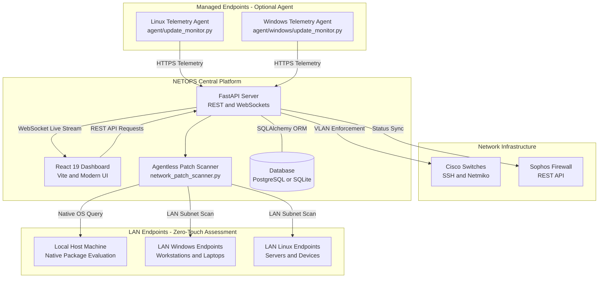

# NETOPS - Network & Endpoint Operations Platform

[](https://fastapi.tiangolo.com)
[](https://react.dev)
[](https://www.python.org)
[](https://www.postgresql.org)
[](https://www.docker.com)
[]()

**NETOPS** is an enterprise-grade Network and Endpoint Operations management platform designed to automate network discovery, enforce device access policies, monitor endpoint patch and security health, and provide real-time auditing and compliance reporting.

---

## 🚀 Key Features

### 🔍 Automated Network Discovery & Device Classification
* Discover active devices across local subnets and switches using ARP, ICMP, and neighbor protocols.
* Automatic vendor MAC OUI resolution and intelligent OS / device type classification (Workstations, Servers, IoT, Network Infrastructure).
* Port-level switch mapping: inspect MAC address tables and identify physical switch port connections.

### 🛡️ Dynamic Access Enforcement & VLAN Automation
* **VLAN Steering & Quarantine**: Automatically quarantine non-compliant, unmanaged, or compromised devices by reassigning switch access VLANs.
* **Scheduled Access Control**: Define granular recurring or one-time network access schedules (e.g. restrict device network connectivity outside work hours).
* **Multi-Vendor Network Integration**:
  * **Cisco IOS / Catalyst**: Automated SSH switch port query and VLAN changes via Netmiko.
  * **Sophos Firewall**: Read-only inspection and perimeter synchronization.

### ⚡ Agentless LAN Patch Assessment (Zero-Touch)
* **Zero Client Software Required**: Identify update compliance status across all machines connected to the same LAN without needing to execute PowerShell scripts, install software agents, or enable remote WinRM/RPC on target machines.
* **Intelligent Subnet Scanning & Fingerprinting**: Auto-detects local network subnets (`192.168.0.0/24`), inspects active LAN endpoints via NetBIOS, TCP port probing (445, 135, 139, 5985, 22), and OS fingerprinting heuristics.
* **Direct Local & Baseline Evaluation**: Evaluates host machine updates directly via native package management (`apt list --upgradable`), while categorizing remote Windows/Linux LAN endpoints into `up_to_date`, `updates_available`, or unmonitored statuses against patch baselines.
* **Synchronized Device Inventory**: Endpoints are automatically updated in the centralized inventory with real-time update compliance badges (🟢 `UP TO DATE`, 🟠 `NEEDS UPDATES`, ⚪ `NO AGENT`) and filterable via the React management dashboard.

### 🔄 Centralized Update Remediation & Command Queue
* **1-Click Immediate Deployment & Scheduled Maintenance Windows**: Centrally deploy updates immediately or schedule them for a specific date/time (e.g., off-peak hours, tonight 11 PM, weekend maintenance).
* **Local Machine Native Remediation**: Automatically invokes native system package managers (`apt-get upgrade -y`) on the host machine in background threads with live progress and streaming logs.
* **Asynchronous Remote Agent Command Queue**: Bypasses Windows Firewall and network port blockages by queueing instructions in NETOPS (`INSTALL_ALL_UPDATES`). Target Windows and Linux agents receive commands during check-in, execute patches natively, and sync status back to NETOPS.
* **Automated Background Dispatcher**: Evaluates scheduled maintenance windows every 10 seconds and automatically activates pending jobs when their scheduled execution time arrives.
* **Real-Time Job Tracking & Audit Logs**: Inspect live execution logs, progress percentage (0-100%), cancel scheduled jobs, and review completion status in the web console or REST API.

### 💻 Endpoint Telemetry & Update Monitoring
* Lightweight background telemetry agent compatible with both **Linux** and **Windows**.
* Tracks OS version, pending security patches, reboot-pending status, and endpoint IP/MAC addresses.
* Periodic heartbeat communication back to the NETOPS central backend to enforce patch compliance.

### 📊 Auditing, Real-Time Streaming & Reporting
* **Real-time Eventing**: Live WebSocket stream broadcasting device discoveries, access enforcement actions, and security alerts directly to the web console.
* **Executive Reports**: Instant one-click generation and download of network inventory and event logs in formatted **PDF** (via ReportLab) and **Excel (.xlsx)** (via OpenPyXL).
* **Simulation Mode**: Built-in mock event and discovery simulation for staging and demonstration without requiring physical hardware.

---

## 🏛️ System Architecture



---

## 📂 Project Structure

```text
NETOPS/
├── agent/                         # Endpoint telemetry agents (optional client agents)
│   ├── update_monitor.py          # Linux telemetry agent
│   └── windows/                   # Windows-specific telemetry agent (WMI / COM)
├── backend/                       # FastAPI application
│   ├── app/
│   │   ├── api/                   # REST API routes (devices, reports, endpoint-updates, cisco, sophos, etc.)
│   │   ├── models/                # SQLAlchemy database models
│   │   ├── schemas/               # Pydantic validation schemas
│   │   ├── services/              # Business logic (discovery, VLAN automation, network patch scanner, remediation)
│   │   ├── config.py              # Environment configuration (pydantic-settings)
│   │   ├── database.py            # Database session and engine setup
│   │   └── main.py                # FastAPI app entry point & WebSocket handlers
│   ├── tests/                     # Test suite (111 comprehensive unit/integration tests)
│   ├── requirements.txt           # Python dependencies
│   └── .env.example               # Template for backend environment variables
├── frontend/                      # React 19 web management console
│   ├── src/                       # UI components, views, styles, and hooks
│   ├── public/                    # Static assets and icons
│   ├── nginx.conf                 # Production reverse-proxy Nginx configuration
│   ├── package.json               # Node.js dependencies & scripts
│   └── vite.config.js             # Vite bundler configuration
├── Dockerfile.backend             # Production Docker container for FastAPI backend
├── Dockerfile.frontend            # Production Docker container for React/Nginx frontend
└── README.md                      # Project documentation
```

---

## ⚡ Quick Start

### Prerequisites
* **Python 3.12+**
* **Node.js 18+** & npm
* **PostgreSQL** (or SQLite for local evaluation)
* **Docker & Docker Compose** (optional, for containerized deployment)

---

### Option 1: Running Locally (Development)

#### 1. Setup Backend
```bash
# Clone the repository
git clone https://github.com/mwangirogers04-cloud/NETOPS.git
cd NETOPS

# Create and activate Python virtual environment
python3 -m venv .venv
source .venv/bin/activate

# Install dependencies
pip install -r backend/requirements.txt

# Configure environment
cp backend/.env.example backend/.env
# Edit backend/.env with your database URL and settings

# Launch FastAPI server
uvicorn backend.app.main:app --host 0.0.0.0 --port 8000 --reload
```
The API and interactive Swagger documentation will be available at:
* Swagger UI: [http://localhost:8000/docs](http://localhost:8000/docs)
* ReDoc: [http://localhost:8000/redoc](http://localhost:8000/redoc)

#### 2. Setup Frontend
```bash
cd frontend

# Install Node dependencies
npm install

# Start Vite development server
npm run dev
```
Open your browser at [http://localhost:5173](http://localhost:5173).

---

### Option 2: Running with Docker

#### Build & Run the Backend:
```bash
docker build -t netops-backend -f Dockerfile.backend .
docker run -d --name netops-backend -p 8000:8000 \
  -e DATABASE_URL=sqlite:///./netops.db \
  netops-backend
```

#### Build & Run the Frontend:
```bash
cd frontend && npm run build && cd ..
docker build -t netops-frontend -f Dockerfile.frontend .
docker run -d --name netops-frontend -p 80:80 netops-frontend
```

---

## 🧪 Running the Automated Test Suite

NETOPS includes a comprehensive suite of 111 automated tests covering discovery logic, agentless LAN patch scanning, centralized patch remediation & scheduled maintenance windows, Cisco/Sophos parsers, access schedule evaluation, report generators, and REST endpoints:

```bash
# Activate virtual environment
source .venv/bin/activate

# Run pytest with PYTHONPATH set
PYTHONPATH=. pytest backend/tests/ -v
```

---

## ⚡ Agentless LAN Patch Assessment (Zero-Touch)

You do **not** need to install agents or run PowerShell scripts on other LAN machines to evaluate patch compliance. NETOPS can perform agentless subnet inspection directly from your host machine.

### Using the Web Console:
1. Open the web interface at [http://localhost:5173](http://localhost:5173).
2. Navigate to **Device Inventory** or **Endpoint Updates**.
3. Click the **⚡ Scan LAN for Updates (Agentless)** button.
4. Filter machines instantly using the compliance filter chips:
   * **Needs Updates**: Machines missing security patches or packages.
   * **Up to Date**: Machines verified against compliant patch baselines.
   * **Unmonitored**: Active LAN devices awaiting initial patch profiling.

### Using the REST API:
```bash
# Scan default auto-detected subnet (e.g., 192.168.0.0/24)
curl -X POST http://localhost:8000/endpoint-updates/scan-lan

# Scan a specific target subnet
curl -X POST "http://localhost:8000/endpoint-updates/scan-lan?network=192.168.1.0/24"
```

---

## 🔄 Centralized Update Remediation & Command Queue

You can centrally deploy updates to any machine on the LAN directly from NETOPS, either immediately or scheduled for off-peak maintenance hours:

### Using the Web Console:
1. In **Device Inventory** or **Endpoint Updates**, locate any machine displaying `⚠️ UPDATES`.
2. Click the **⚡ Deploy Updates** button to open the deployment modal.
3. Select your desired **Deployment Timing**:
   * **⚡ Deploy Now**:
     * **Local Machine**: NETOPS triggers native package manager (`apt-get upgrade -y`) in a background thread and streams live execution logs.
     * **Remote LAN Machines**: NETOPS queues an active command. When the machine's background agent heartbeats, it automatically runs the native update engine and reports completion.
   * **📅 Schedule for Date & Time**:
     * Pick a future date and time using the interactive picker, or choose quick off-peak presets (**Tonight 11:00 PM**, **Tomorrow 2:00 AM**, **Weekend Sat 3:00 AM**).
     * The job enters `SCHEDULED` status and remains dormant until the target time arrives.
     * When due, the NETOPS automated background dispatcher automatically triggers the update or activates it for agent check-in.
4. Click **📋 Update Jobs** to inspect live execution logs, view progress percentages, or cancel scheduled maintenance windows anytime before execution.

### Using the REST API:
```bash
# 1. Queue an immediate update deployment job
curl -X POST http://localhost:8000/endpoint-updates/jobs \
  -H "Content-Type: application/json" \
  -d '{"hostname": "DESKTOP-8N0NNSL", "action": "INSTALL_ALL_UPDATES"}'

# 2. Schedule an update deployment job for a future maintenance window
curl -X POST http://localhost:8000/endpoint-updates/jobs \
  -H "Content-Type: application/json" \
  -d '{"hostname": "DESKTOP-8N0NNSL", "action": "INSTALL_ALL_UPDATES", "scheduled_at": "2026-10-17T02:00:00Z"}'

# 3. View all patch jobs, scheduled dates, and real-time execution logs
curl -s http://localhost:8000/endpoint-updates/jobs

# 4. Cancel a scheduled or queued job
curl -X POST http://localhost:8000/endpoint-updates/jobs/1/cancel
```

---

## 📡 Running the Telemetry Agent (Optional)

For managed corporate client machines requiring real-time continuous telemetry heartbeats, you can optionally execute the background agent:

### On Linux:
```bash
python3 agent/update_monitor.py
```

### On Windows:
```powershell
python agent\windows\update_monitor.py
```

---

## 📄 License & Attribution

Developed for Network Operations & Endpoint Security automation.  
Distributed under standard enterprise open-source licensing.
